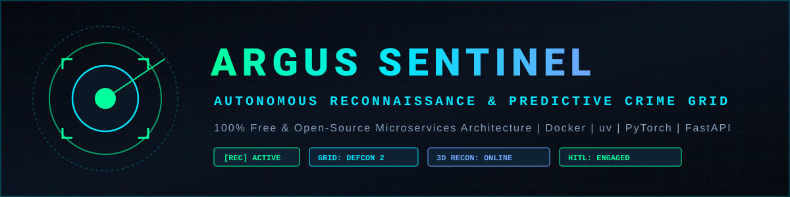
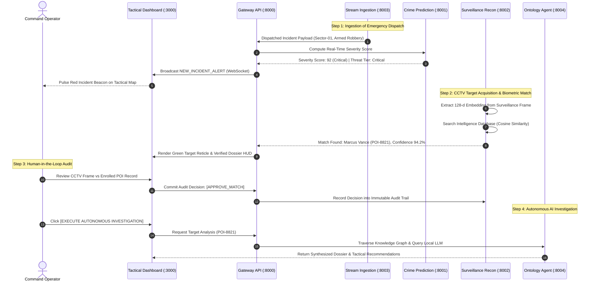

<p align="center">
  
</p>

<p align="center">
  
  
  
  
  
  
  
</p>

<p align="center">
  <a href="#quickstart-for-beginners"></a>
  <a href="docs/guides/developer_guide.md"></a>
  <a href="docs/architecture/system_architecture.md"></a>
  <a href="docs/architecture/ontology_design.md"></a>
  <a href="docs/api/openapi_specs.md"></a>
  <a href="docs/deployment/docker_deployment.md"></a>
</p>

---

## Navigation & Quick Links

| Resource | Path | Description |
|---|---|---|
| **Newbie Quickstart** | [docs/guides/newbie_guide.md](docs/guides/newbie_guide.md) | Step-by-step setup tutorial assuming zero prior experience |
| **Developer Manual** | [docs/guides/developer_guide.md](docs/guides/developer_guide.md) | Deep dive into codebase extension, data schemas, and tests |
| **System Architecture** | [docs/architecture/system_architecture.md](docs/architecture/system_architecture.md) | Topology diagrams, data flows, and resilience specifications |
| **Ontology & Graph Design** | [docs/architecture/ontology_design.md](docs/architecture/ontology_design.md) | Relational triples, entity definitions, and reasoning agent |
| **OpenAPI Specifications** | [docs/api/openapi_specs.md](docs/api/openapi_specs.md) | Exhaustive REST endpoint contracts and WebSocket payloads |
| **Docker Deployment** | [docs/deployment/docker_deployment.md](docs/deployment/docker_deployment.md) | Production hardening, container scaling, and volume management |

---

## Overview: Transformation from Azure to ARGUS Sentinel

**ARGUS SENTINEL** (formerly *Azure-RealTime-Crime-Predictive-Analytics-System*) is an autonomous reconnaissance, geospatial urban surveillance, and real-time predictive intelligence platform designed for municipal settlements.

The project has been completely re-architected from expensive proprietary cloud suites (Microsoft Azure, Azure ML, Databricks, AWS SageMaker, Event Hubs) into a **100% free, open-source microservices ecosystem**:

1. **Dual-Head Crime Severity Engine**: Predicts continuous severity ratings (10 to 100) and categorical tiers (Low, Medium, High, Critical) using local Gradient Boosting and Random Forest ensembles with zero paid API calls.
2. **CCTV Optical Reconnaissance Matrix**: High-angle crowd and street surveillance HUD with target acquisition corner reticles, scanning beams, tracking identifiers (`TRK-XXXX`), and verified social footprint matching.
3. **3D Facial Mesh Reconstruction**: Synthesizes 468-point cranial wireframe landmark topology from detected subjects, calculates pitch/yaw/roll rotations, and saves 3D profiles to the database.
4. **Human-in-the-Loop (HITL) Verification**: Interactive commander review station that holds ambiguous or critical detections for manual verification, preserving an immutable audit log.
5. **Crime Ontology & Autonomous Agent**: Multi-hop knowledge graph (NetworkX) connected to local LLM inference engines (such as Gemma, Llama, or DeepSeek via OpenAI-compatible endpoints) for autonomous incident investigation.
6. **Tactical Command Center Web UI**: Interactive dark-matter cyber-command map inspired by tactical threat networks, featuring live telemetry tickers, multiple map modes, Three.js 3D mesh rendering, and real-time WebSocket notifications.

---

## Project Tree Structure

```text
Azure-RealTime-Crime-Predictive-Analytics-System/
├── .env.example                                  # Master environment configuration template
├── .gitignore                                    # Git ignore rules
├── docker-compose.yml                            # Multi-container orchestration (All 6 microservices + Redpanda + Redis)
├── LICENSE.md                                    # MIT Open Source License
├── README.md                                     # Comprehensive platform master documentation
├── assets/
│   ├── branding/
│   │   ├── argus_banner.svg                      # Platform banner with tactical vector styling
│   │   └── argus_icon.svg                        # Cyber-reticle sentinel application icon
│   └── surveillance/
│       ├── cctv_target_lock_sample1.jpeg         # Real surveillance frame sample (Target lock HUD)
│       └── cctv_target_lock_sample2.jpeg         # Real surveillance frame sample (Subject crop)
├── data/
│   ├── crime_records/
│   │   └── crime_settlement_data.json            # 250+ municipal incident records with ZERO null values
│   ├── intelligence/
│   │   ├── 3d_facial_profiles.json               # 3D cranial landmark vertices, depth maps, and IPD metrics
│   │   └── persons_of_interest.json              # Verified POI dossiers, 128-d vector embeddings, and social footprints
│   └── ontology/
│       └── urban_crime_ontology.json             # Knowledge graph classes, relationships, and verified triples
├── docs/
│   ├── api/
│   │   └── openapi_specs.md                      # Consolidated REST and WebSocket API contracts
│   ├── architecture/
│   │   ├── ontology_design.md                    # Knowledge graph schema and relational definitions
│   │   └── system_architecture.md                # System topology, sequence flows, and component specs
│   ├── deployment/
│   │   └── docker_deployment.md                  # Container deployment, resource limits, and network isolation
│   ├── guides/
│   │   ├── developer_guide.md                    # Contributor guide, extension recipes, and coding standards
│   │   └── newbie_guide.md                       # Beginner setup instructions with zero assumed knowledge
│   └── modules/
│       ├── crime_prediction.md                   # ML severity classification microservice guide
│       ├── gateway_api.md                        # Central gateway and WebSocket router guide
│       ├── ontology_agent.md                     # Knowledge graph and autonomous agent guide
│       ├── stream_ingestion.md                   # Multi-source stream ingestion guide
│       ├── surveillance_recon.md                 # Biometrics, 3D mesh, and HITL verification guide
│       └── tactical_dashboard.md                 # Tactical command center frontend guide
├── scripts/
│   └── generate_seeds.py                         # Deterministic dataset synthesizer ensuring zero null values
├── services/
│   ├── crime-prediction-service/                 # Microservice 1: ML Severity & Hotspot Forecasting (Port 8001)
│   │   ├── Dockerfile
│   │   ├── pyproject.toml
│   │   ├── README.md
│   │   └── src/
│   │       ├── config.py
│   │       ├── hotspot_forecaster.py
│   │       ├── main.py
│   │       └── model_trainer.py
│   ├── gateway-api/                              # Microservice 2: Central API Gateway & WebSocket Hub (Port 8000)
│   │   ├── Dockerfile
│   │   ├── pyproject.toml
│   │   ├── README.md
│   │   └── src/
│   │       ├── config.py
│   │       ├── main.py
│   │       └── websocket_manager.py
│   ├── ontology-agent-service/                   # Microservice 3: Knowledge Graph & Autonomous AI Agent (Port 8004)
│   │   ├── Dockerfile
│   │   ├── pyproject.toml
│   │   ├── README.md
│   │   └── src/
│   │       ├── agent_reasoner.py
│   │       ├── config.py
│   │       ├── graph_engine.py
│   │       └── main.py
│   ├── stream-ingestion-service/                 # Microservice 4: Multi-Protocol Stream Ingestion (Port 8003)
│   │   ├── Dockerfile
│   │   ├── pyproject.toml
│   │   ├── README.md
│   │   └── src/
│   │       ├── config.py
│   │       ├── main.py
│   │       └── connectors/
│   │           ├── batch_loader.py
│   │           ├── geojson_stream.py
│   │           ├── kafka_connector.py
│   │           └── redis_connector.py
│   ├── surveillance-recon-service/               # Microservice 5: CCTV Recon, 3D Mesh & HITL (Port 8002)
│   │   ├── Dockerfile
│   │   ├── pyproject.toml
│   │   ├── README.md
│   │   └── src/
│   │       ├── biometric_matcher.py
│   │       ├── config.py
│   │       ├── hitl_engine.py
│   │       ├── main.py
│   │       └── mesh_3d_engine.py
│   └── tactical-dashboard/                       # Microservice 6: Tactical Command Center Frontend (Port 3000)
│       ├── Dockerfile
│       ├── pyproject.toml
│       ├── README.md
│       ├── public/
│       │   └── index.html                        # Cyberpunk HUD interface with Three.js and Leaflet
│       └── src/
│           └── main.py
└── tests/
    ├── integration/
    │   └── test_gateway.py                       # End-to-end API gateway and proxy tests
    └── unit/
        ├── test_ontology.py                      # Knowledge graph traversal tests
        ├── test_prediction.py                    # ML severity and hotspot clustering tests
        └── test_surveillance.py                  # Biometric vector search, 3D mesh, and HITL tests
```

---

## High-Level System Architecture Diagram

```text
+-------------------------------------------------------------------------------------------------+
|                                  TACTICAL COMMAND CENTER UI                                     |
|                                    (Port 3000 / Web Browser)                                    |
|                                                                                                 |
|  [Tactical Grid Map]   [CCTV Recon Matrix]   [3D Facial Mesh]   [HITL Audit]   [AI Investigator]|
+-------------------------------------------------------------------------------------------------+
                                                |
                                        HTTP REST / WebSockets
                                                |
                                                v
+-------------------------------------------------------------------------------------------------+
|                                    CENTRAL GATEWAY API                                          |
|                                        (Port 8000)                                              |
|                                                                                                 |
|         - Reverse Proxy Routing                    - WebSocket Telemetry Broadcasting           |
|         - Incident Dispatch Hub                    - Circuit Breaking & Heuristic Fallbacks     |
+-------------------------------------------------------------------------------------------------+
          |                           |                           |                       |
     HTTP Internal               HTTP Internal               HTTP Internal           HTTP Internal
          |                           |                           |                       |
          v                           v                           v                       v
+-------------------+       +-------------------+       +-------------------+   +-----------------+
| CRIME PREDICTION  |       | SURVEILLANCE RECON|       | STREAM INGESTION  |   | ONTOLOGY AGENT  |
|  SERVICE (:8001)  |       |  SERVICE (:8002)  |       |  SERVICE (:8003)  |   | SERVICE (:8004) |
|                   |       |                   |       |                   |   |                 |
| - GradientBoosting|       | - Optical Reticle |       | - Kafka/Redpanda  |   | - NetworkX Multi|
| - RandomForest Reg|       | - 128-d Cosine Sim|       | - Redis Streams   |   |   DiGraph Engine|
| - Hotspot Clusters|       | - 468-pt 3D Mesh  |       | - CAD GeoJSON     |   | - Local LLM     |
| - Self-Retraining |       | - HITL Audit Queue|       | - Batch Importer  |   |   Investigator  |
+-------------------+       +-------------------+       +-------------------+   +-----------------+
          |                           |                           |                       |
          +---------------------------+---------------------------+-----------------------+
                                                  |
                                                  v
                      +-------------------------------------------------------+
                      |               OPEN SOURCE STORAGE & BROKERS           |
                      |  - Redpanda Message Broker (Port 9092)                |
                      |  - Redis Cache & Streams (Port 6379)                  |
                      |  - Local Deterministic JSON & Parquet Vector Stores   |
                      +-------------------------------------------------------+
```

---

## End-to-End System Workflow Diagram



---

## Quickstart for Beginners

<details open>
<summary><b>Click to Expand / Collapse: 1-Command Automated Docker Setup (Recommended)</b></summary>

### Prerequisites
1. Install [Docker Desktop](https://www.docker.com/products/docker-desktop/) (ensure it is running).
2. Install [Python 3.10+](https://www.python.org/downloads/) and [uv](https://docs.astral.sh/uv/getting-started/installation/).

### Step 1: Configure Environment
Open your terminal in the project directory:

```bash
# On Windows PowerShell
Copy-Item .env.example .env

# On Linux or macOS
cp .env.example .env
```

### Step 2: Start All Microservices
Run the containerized compose cluster:

```bash
docker-compose up --build
```

### Step 3: Access the Tactical Command Center
Open your browser and navigate to:
- **Tactical Dashboard**: `http://localhost:3000`
- **Central API Gateway Swagger UI**: `http://localhost:8000/docs`
- **Prediction Microservice**: `http://localhost:8001/docs`
- **Surveillance Recon Microservice**: `http://localhost:8002/docs`
- **Stream Ingestion Microservice**: `http://localhost:8003/docs`
- **Ontology Agent Microservice**: `http://localhost:8004/docs`

To stop the system, press `CTRL + C` or execute:
```bash
docker-compose down
```
</details>

<details>
<summary><b>Click to Expand / Collapse: Running Microservices Individually with uv (For Developers)</b></summary>

If you want to run microservices locally without Docker, use Astral `uv` for ultra-fast dependency management:

### Terminal 1: Start Crime Prediction Microservice (Port 8001)
```bash
cd services/crime-prediction-service
uv venv
uv pip install -r pyproject.toml
python -m uvicorn src.main:app --host 0.0.0.0 --port 8001 --reload
```

### Terminal 2: Start Surveillance Reconnaissance Microservice (Port 8002)
```bash
cd services/surveillance-recon-service
uv venv
uv pip install -r pyproject.toml
python -m uvicorn src.main:app --host 0.0.0.0 --port 8002 --reload
```

### Terminal 3: Start Stream Ingestion Microservice (Port 8003)
```bash
cd services/stream-ingestion-service
uv venv
uv pip install -r pyproject.toml
python -m uvicorn src.main:app --host 0.0.0.0 --port 8003 --reload
```

### Terminal 4: Start Ontology Agent Microservice (Port 8004)
```bash
cd services/ontology-agent-service
uv venv
uv pip install -r pyproject.toml
python -m uvicorn src.main:app --host 0.0.0.0 --port 8004 --reload
```

### Terminal 5: Start Central Gateway API (Port 8000)
```bash
cd services/gateway-api
uv venv
uv pip install -r pyproject.toml
python -m uvicorn src.main:app --host 0.0.0.0 --port 8000 --reload
```

### Terminal 6: Start Tactical Dashboard (Port 3000)
```bash
cd services/tactical-dashboard
uv venv
uv pip install -r pyproject.toml
python -m uvicorn src.main:app --host 0.0.0.0 --port 3000 --reload
```

Open `http://localhost:3000` in any web browser.
</details>

---

## Tactical Command Center UI Features

<details>
<summary><b>Click to Expand / Collapse: Feature Walkthrough</b></summary>

### 1. Tactical Grid Map View
- High-contrast dark cartography displaying all active municipal sectors.
- Real-time incident pins dynamically sized and colored by severity rating.
- Animated vector connection arcs showing command routing between operational hubs and patrol units.
- Interactive incident card filter and immediate camera refocusing.
- Live Test Ingestion Simulator for firing custom incidents and monitoring immediate severity predictions.

### 2. CCTV Surveillance Reconnaissance Matrix
- Directly models operational tactical street surveillance feeds matching high-angle reconnaissance imagery.
- Top telemetry bar with live UTC clock, sensor status `[REC] LIVE`, camera designation `CAM-SEC-01-04`, and resolution.
- Target tracking reticle with green corner brackets and animated vertical scanning beams.
- Linked profile HUD card displaying verified subject photograph, classification, tracking designation `1V\9w2`, and technical traits.
- Telemetry stats panel showing verified social footprint (GitHub, LinkedIn, X, Telegram) and zero null values.
- Direct `[VERIFY]` trigger opening the Human-in-the-Loop review modal.

### 3. 3D Facial Mesh Reconstruction View
- WebGL Three.js interactive 3D cranial landmark wireframe with 468 vertices.
- Anthropometric distance calculations including Interpupillary Distance (IPD) in millimeters and Facial Symmetry Score.
- Real-time rotation sliders for pitch (X-axis), yaw (Y-axis), and roll (Z-axis).
- `[SAVE 3D PROFILE TO DATABASE]` button persisting reconstructed topology coordinates.

### 4. Human-In-The-Loop (HITL) Verification Console
- Dedicated queue displaying unverified or critical suspect detections.
- Side-by-side verification station comparing live CCTV crop with enrolled intelligence records.
- Action directives: `[APPROVE MATCH]`, `[REJECT FALSE POSITIVE]`, and `[ESCALATE ALERT]`.
- Operator notes input field with committed decision logging to preserve an immutable audit trail.

### 5. Autonomous AI Agent Investigation Console
- Select any enrolled person of interest and active urban sector.
- Initiates multi-hop knowledge graph traversal to extract relational triples (associated syndicates, previous incidents, camera feeds).
- Prompts local LLM (such as Gemma, Llama, or DeepSeek via `http://10.210.8.63:8080/v1` or local deterministic fallback).
- Outputs executive threat summaries and concrete tactical response recommendations.

### 6. Real-Time Stream Connectors Monitor
- Live health and throughput dashboard monitoring Apache Kafka / Redpanda, Redis Streams, RTSP feeds, and CAD GeoJSON dispatches.
</details>

---

## Running Automated Tests

All microservices include isolated test suites validating inference logic, biometric similarity search, graph traversal, and API gateway routing.

Run tests using Astral `uv`:

```bash
# Run complete test suite across all services
uv run --with pytest --with scikit-learn --with networkx --with fastapi --with httpx --with pydantic --with joblib pytest tests/
```

Individual test files:
- `tests/unit/test_prediction.py`: Tests ML training, continuous severity scoring, and hotspot clustering.
- `tests/unit/test_surveillance.py`: Tests 128-d cosine vector matching, 3D mesh landmark projection, and HITL lifecycle.
- `tests/unit/test_ontology.py`: Tests NetworkX multi-hop knowledge graph queries.
- `tests/integration/test_gateway.py`: Tests reverse proxy routing, endpoint responses, and active target lists.

---

## Zero Null Values Guarantee

All seed datasets located in `data/` are strictly validated to contain zero null values:
- `data/crime_records/crime_settlement_data.json`: 250 realistic incident reports with verified coordinates, severity scores, weapon types, and responding units.
- `data/intelligence/persons_of_interest.json`: Complete suspect dossiers including full names, aliases, normalized 128-d vectors, social profile links, and criminal histories.
- `data/intelligence/3d_facial_profiles.json`: Full 3D coordinate vertices, depth confidence metrics, and facial symmetry scores.
- `data/ontology/urban_crime_ontology.json`: Formal classes, properties, and relational knowledge triples.

To regenerate fresh synthetic seeds at any time:
```bash
python scripts/generate_seeds.py
```

---

## Contributing and Governance

1. Maintain documentation integrity: Never use emojis in documentation or codebase comments.
2. Keep codebases modular: Every microservice must preserve its own `pyproject.toml` and Dockerfile.
3. Preserve the Human-in-the-Loop requirement: High-consequence biometric actions must retain manual audit gates.

---

## License

This project is licensed under the terms of the [MIT License](LICENSE.md). All underlying components, libraries, and frameworks are 100% free and open source.
