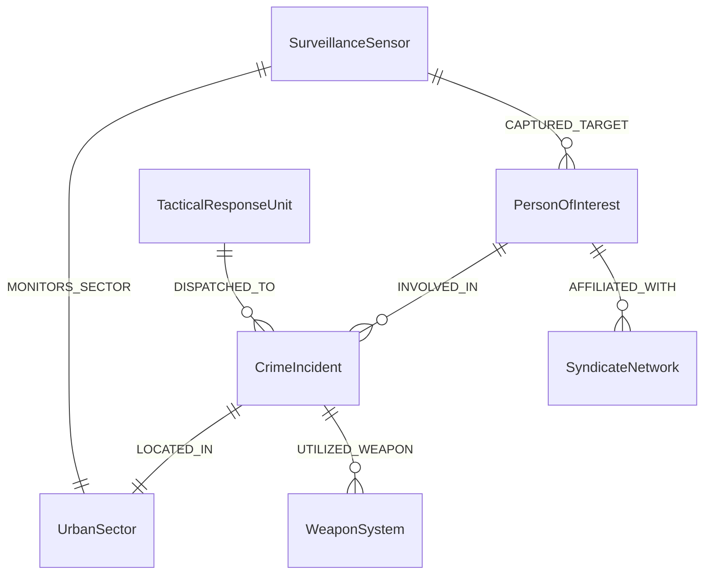

# ARGUS Sentinel - Crime Ontology & Knowledge Graph Architecture

## 1. Overview

The ARGUS Crime Ontology represents municipal crime entities, their attributes, and their causal relationships as a formal knowledge graph. This graph enables multi-hop relational inference, network centrality analysis, and contextual prompting for autonomous investigation agents.

## 2. Ontology Entity Classes

- `PersonOfInterest`: Suspects, persons of interest, and associates. Contains verified biometric embeddings, physical descriptions, and social profiles.
- `CrimeIncident`: Event reports including timestamps, categories, weapon involvement, premise types, and geographic coordinates.
- `SurveillanceSensor`: Fixed and mobile optical sensors, field-of-view parameters, and camera locations.
- `WeaponSystem`: Firearm types, blunt instruments, or cyber infiltration toolkits.
- `UrbanSector`: Geographic municipal administrative zones and settlement districts.
- `SyndicateNetwork`: Criminal syndicates, logistics cartels, or cyber operations collectives.
- `TacticalResponseUnit`: Emergency response vehicles, patrol units, and quick-reaction teams.

## 3. Relational Schema Diagram



<details>
<summary>Click to Expand Knowledge Triples Representation</summary>

### Triples Sample

```json
[
  {"subject": "POI-8821", "predicate": "INVOLVED_IN", "object": "INC-2026-0012"},
  {"subject": "POI-8821", "predicate": "AFFILIATED_WITH", "object": "DarkFiber Syndicate"},
  {"subject": "CAM-SEC-01-04", "predicate": "CAPTURED_TARGET", "object": "POI-8821"},
  {"subject": "INC-2026-0012", "predicate": "LOCATED_IN", "object": "SEC-01"},
  {"subject": "POI-9043", "predicate": "INVOLVED_IN", "object": "INC-2026-0045"},
  {"subject": "POI-9043", "predicate": "AFFILIATED_WITH", "object": "BlackWave Logistics"},
  {"subject": "CAM-SEC-02-01", "predicate": "CAPTURED_TARGET", "object": "POI-9043"},
  {"subject": "UNIT-108", "predicate": "DISPATCHED_TO", "object": "INC-2026-0012"}
]
```

### Agentic Querying Workflow

When an analyst initiates an investigation:
1. `CrimeOntologyGraphEngine` executes an $N$-hop breadth-first traversal starting from the subject's node.
2. The traversal extracts all directly affiliated syndicates, co-suspects, previous incidents, and monitoring sensors.
3. The extracted triples are serialized into concise factual prompts for the local LLM.
4. The LLM generates actionable law enforcement recommendations without hallucinating unverified connections.
</details>
