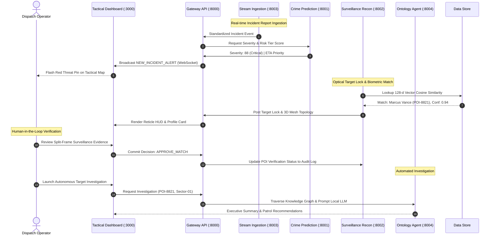

# ARGUS Sentinel - System Architecture Specification

## 1. Executive Architecture Summary

ARGUS Sentinel is an event-driven, microservices-based urban crime surveillance and predictive analytics platform. It migrates all legacy dependencies away from proprietary cloud services (such as Azure Machine Learning, Databricks, and AWS SageMaker) to an entirely self-hostable, containerized stack composed of free and open-source technologies.

## 2. Global Component Topology

```text
+-----------------------------------------------------------------------------------------+
|                                    OPERATOR / BROWSER                                   |
|                          Tactical Dashboard Web UI (:3000)                              |
+-----------------------------------------------------------------------------------------+
                                          |
                                    HTTP / WebSocket
                                          |
                                          v
+-----------------------------------------------------------------------------------------+
|                                   GATEWAY API (:8000)                                   |
|                       Reverse Proxy, Routing & WebSocket Manager                         |
+-----------------------------------------------------------------------------------------+
          |                         |                        |                     |
     Internal HTTP             Internal HTTP            Internal HTTP         Internal HTTP
          |                         |                        |                     |
          v                         v                        v                     v
+--------------------+    +--------------------+   +-------------------+  +---------------+
|  CRIME PREDICTION  |    | SURVEILLANCE RECON |   | STREAM INGESTION  |  | ONTOLOGY AGENT|
|   SERVICE (:8001)  |    |   SERVICE (:8002)  |   |  SERVICE (:8003)  |  | SERVICE(:8004)|
|                    |    |                    |   |                   |  |               |
| - GradientBoosting |    | - CCTV Target HUD  |   | - Kafka/Redpanda  |  | - NetworkX    |
| - RandomForest Reg |    | - Biometric Vector |   | - Redis Streams   |  |   MultiDiGraph|
| - Hotspot Clusters |    | - 3D Mesh (468 lm) |   | - CAD GeoJSON     |  | - Local LLM   |
| - Self-Training    |    | - HITL Verification|   | - Batch CSV Loader|  |   Investigator|
+--------------------+    +--------------------+   +-------------------+  +---------------+
          |                         |                        |                     |
          +-------------------------+------------------------+---------------------+
                                          |
                                          v
                     +-------------------------------------------+
                     |         PERSISTENCE & EVENT FABRIC        |
                     |  - Redpanda Broker (:9092)                |
                     |  - Redis Cache & Streams (:6379)          |
                     |  - Local Data Lake & JSON Vector Stores   |
                     +-------------------------------------------+
```

## 3. Detailed Data Flow Model



<details>
<summary>Click to Expand Fault Tolerance and Scalability Features</summary>

### 1. High-Availability Messaging
The architecture employs Redpanda, a native C++ drop-in replacement for Apache Kafka. It provides sub-millisecond latencies and zero-JVM overhead, making it ideal for deployment on edge servers, regional precincts, or container clusters.

### 2. Zero-Loss Circuit Breaking
If any peripheral microservice is temporarily unavailable:
- The Gateway API serves cached or deterministic heuristic outputs to keep user dashboards fully operational.
- The Stream Ingestion engine buffers events locally in Redis Streams until downstream services reconnect.

### 3. Edge-Compatible Biometrics
Biometric matching utilizes normalized Euclidean and Cosine distances computed via NumPy, avoiding heavy third-party GPU licensing requirements while maintaining sub-10ms search speeds over thousands of enrolled subjects.
</details>
