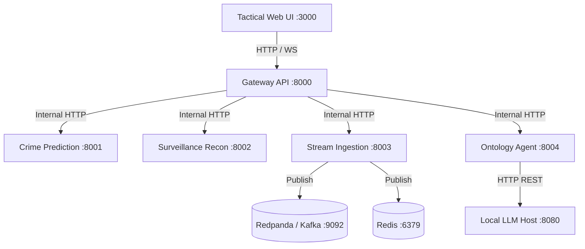

# ARGUS Sentinel - Developer Guide

Architectural specifications, extension patterns, data structures, and contribution standards for software engineers extending ARGUS Sentinel.

## 1. System Design Principles

- **Zero Cloud-Vendor Lock-In**: Replaces proprietary Azure ML, Databricks, and Event Hubs with standard open-source equivalents (FastAPI, scikit-learn, Redpanda, Redis Streams, Three.js).
- **Loose Coupling via Microservices**: Every business capability resides in an isolated directory with its own `pyproject.toml`, Dockerfile, tests, and documentation.
- **Data Integrity Guarantee**: Zero null values across municipal datasets and intelligence dossiers.
- **Human Governance by Design**: Autonomous AI features (biometric matching, LLM investigations) feed into an audited Human-in-the-Loop (HITL) pipeline.

## 2. Global Repository Layout

```text
Azure-RealTime-Crime-Predictive-Analytics-System/
├── .env.example
├── .gitignore
├── docker-compose.yml
├── LICENSE.md
├── README.md
├── assets/
│   ├── branding/
│   │   ├── argus_banner.svg
│   │   └── argus_icon.svg
│   └── surveillance/
│       ├── cctv_target_lock_sample1.jpeg
│       └── cctv_target_lock_sample2.jpeg
├── data/
│   ├── crime_records/
│   │   └── crime_settlement_data.json
│   ├── intelligence/
│   │   ├── 3d_facial_profiles.json
│   │   └── persons_of_interest.json
│   └── ontology/
│       └── urban_crime_ontology.json
├── docs/
│   ├── api/
│   ├── architecture/
│   ├── deployment/
│   ├── guides/
│   └── modules/
├── scripts/
│   └── generate_seeds.py
└── services/
    ├── crime-prediction-service/
    ├── gateway-api/
    ├── ontology-agent-service/
    ├── stream-ingestion-service/
    ├── surveillance-recon-service/
    └── tactical-dashboard/
```

## 3. Microservice Network Communication



<details>
<summary>Click to Expand Extension and Implementation Recipes</summary>

### How to Add a New Machine Learning Model

1. Navigate to `services/crime-prediction-service/src/model_trainer.py`.
2. Implement your training logic using scikit-learn, XGBoost, or PyTorch.
3. Serialize artifacts to the `artifacts/` folder with `joblib` or ONNX.
4. Expose the prediction logic via `services/crime-prediction-service/src/main.py`.

### How to Add a New Surveillance Video Feed

1. Open `services/gateway-api/src/main.py` and register the camera in the `get_cameras()` endpoint with ID, geographic sector, and RTSP stream URI.
2. In `data/intelligence/persons_of_interest.json`, ensure target subjects have appropriate `last_observed_camera` associations.

### How to Extend Knowledge Graph Ontology

1. Edit `data/ontology/urban_crime_ontology.json`.
2. Add new entity nodes or relationships to the `knowledge_triples` array.
3. The `CrimeOntologyGraphEngine` in `services/ontology-agent-service/src/graph_engine.py` automatically rebuilds the MultiDiGraph in NetworkX on subsequent requests.
</details>

## 4. Testing Standards

Every microservice includes automated unit and integration tests. Run tests across all services using `pytest`:

```bash
# Gateway API Tests
cd services/gateway-api
uv run pytest

# Prediction Service Tests
cd ../crime-prediction-service
uv run pytest

# Surveillance Service Tests
cd ../surveillance-recon-service
uv run pytest
```
