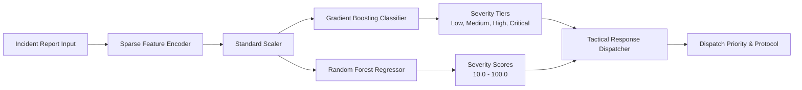

# ARGUS Sentinel - Crime Prediction Module Documentation

Provides real-time severity classification, regression scoring, and spatial hotspot forecasting.

## Module Tree Structure

```text
services/crime-prediction-service/
├── Dockerfile
├── pyproject.toml
├── README.md
└── src/
    ├── config.py
    ├── hotspot_forecaster.py
    ├── main.py
    └── model_trainer.py
```

## Workflow Diagram



<details>
<summary>Click to Expand Model Architecture and Metrics</summary>

### Algorithms
- **Classifier**: Multi-class Gradient Boosting with 60 estimators and max depth 4.
- **Regressor**: Random Forest with 50 trees for continuous risk calibration.
- **Spatial Clustering**: Mean coordinate aggregation weighted by severity and historical density.

### Key Endpoints
- `POST /predict/severity`: Single incident inference.
- `POST /predict/batch`: High-throughput batch scoring.
- `GET /predict/hotspots`: Geospatial risk clusters across municipal sectors.
- `POST /train`: On-demand model retraining.
- `GET /metrics`: Current model performance benchmarks.
</details>
