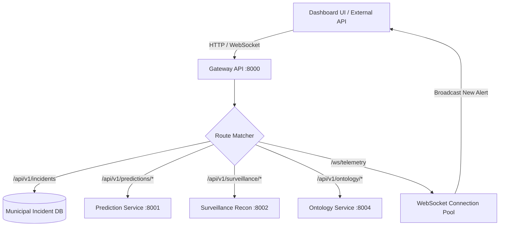

# ARGUS Sentinel - Gateway API Module Documentation

The central ingress and egress point of the ARGUS platform. It manages HTTP REST routing, circuit breaking, and real-time WebSocket distribution.

## Module Tree Structure

```text
services/gateway-api/
├── Dockerfile
├── pyproject.toml
├── README.md
└── src/
    ├── config.py
    ├── main.py
    └── websocket_manager.py
```

## Workflow Diagram



<details>
<summary>Click to Expand Configuration and Parameters</summary>

### Environment Variables
- `GATEWAY_PORT`: Port to listen on (default `8000`).
- `GATEWAY_HOST`: Binding host interface (default `0.0.0.0`).
- `PREDICTION_SERVICE_URL`: Downstream prediction engine URI.
- `SURVEILLANCE_SERVICE_URL`: Downstream reconnaissance service URI.
- `INGESTION_SERVICE_URL`: Downstream ingestion service URI.
- `ONTOLOGY_SERVICE_URL`: Downstream knowledge graph service URI.

### Core Endpoints
- `GET /health`: Health and telemetry check.
- `GET /api/v1/incidents`: Filterable incident record retrieval.
- `POST /api/v1/incidents`: Real-time incident ingestion and alert broadcast.
- `GET /api/v1/surveillance/targets/active`: Current active optical tracking targets.
- `POST /api/v1/surveillance/hitl/verify`: Operator verification commit.
</details>
