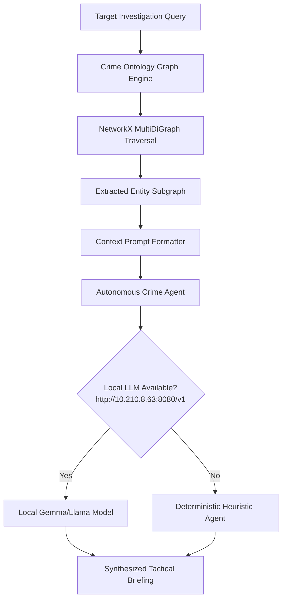

# ARGUS Sentinel - Ontology & Agentic Reasoning Module

Knowledge graph and autonomous AI investigation service powered by local LLMs with zero paid cloud dependencies.

## Module Tree Structure

```text
services/ontology-agent-service/
├── Dockerfile
├── pyproject.toml
├── README.md
└── src/
    ├── agent_reasoner.py
    ├── config.py
    ├── graph_engine.py
    └── main.py
```

## Workflow Diagram



<details>
<summary>Click to Expand Agent Configuration and Local LLM Integration</summary>

### Local LLM Settings
Configured via `.env`:
- `LLM_PROVIDER`: `openai` (compatible format)
- `LLM_MODEL`: `google/gemma-4-E4B-it-qat-q4_0-gguf:Q4_0`
- `LLM_BASE_URL`: `http://10.210.8.63:8080/v1`
- `LLM_ENABLE_THINKING`: `true`

### Endpoints
- `GET /graph/schema`: Full ontology graph definition.
- `GET /graph/entity/{entity_id}`: All direct connections for a suspect, camera, or syndicate.
- `POST /agent/investigate`: Generate tactical investigation briefing.
</details>
