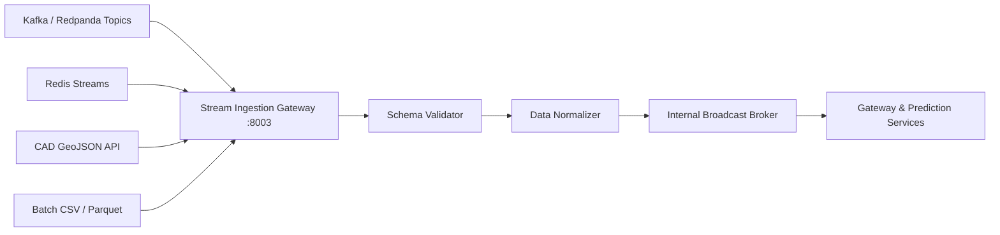

# ARGUS Sentinel - Stream Ingestion Module Documentation

Ingestion engine supporting Apache Kafka, Redpanda, Redis Streams, RTSP feeds, and GeoJSON CAD dispatches.

## Module Tree Structure

```text
services/stream-ingestion-service/
├── Dockerfile
├── pyproject.toml
├── README.md
└── src/
    ├── config.py
    ├── main.py
    └── connectors/
        ├── batch_loader.py
        ├── geojson_stream.py
        ├── kafka_connector.py
        └── redis_connector.py
```

## Workflow Diagram



<details>
<summary>Click to Expand Connector Specifications</summary>

### Connector Reference
- `KafkaStreamConnector`: Uses binary Kafka protocol to read from topic `argus.incidents.raw`.
- `RedisStreamConnector`: Streams normalized incident events into key `argus:stream:telemetry`.
- `GeoJSONStreamParser`: Converts Emergency Dispatch geometry features into standardized incident payloads.
- `BatchDatasetLoader`: Bulk ingestion utility for municipal historical archives.

### Endpoints
- `POST /ingest/event`: Ingest raw event payload with source protocol indicator.
- `GET /ingest/status`: Active pipeline status and event ingestion throughput.
</details>
