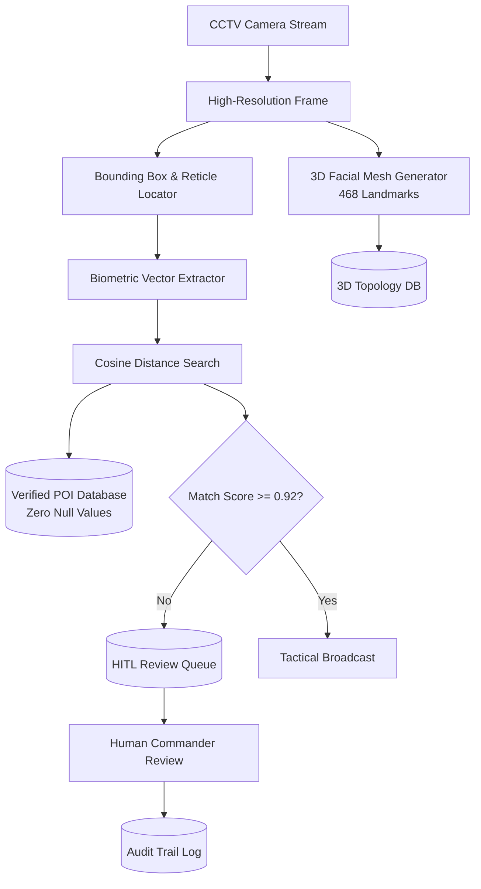

# ARGUS Sentinel - Surveillance Reconnaissance & 3D Profiling Module

Provides CCTV target tracking, biometric cosine matching, 3D facial mesh reconstruction, and Human-in-the-Loop review.

## Module Tree Structure

```text
services/surveillance-recon-service/
├── Dockerfile
├── pyproject.toml
├── README.md
└── src/
    ├── biometric_matcher.py
    ├── config.py
    ├── hitl_engine.py
    ├── main.py
    └── mesh_3d_engine.py
```

## Workflow Diagram



<details>
<summary>Click to Expand Biometrics and 3D Mesh Details</summary>

### 3D Facial Reconstruction
- Analyzes facial landmarks across nasal, ocular, oral, and jaw contours.
- Generates 3D coordinates $(x, y, z)$ alongside pitch, yaw, and roll pose angles.
- Computes facial symmetry index and interpupillary distance (IPD) in millimeters.

### Endpoints
- `POST /recon/match/vector`: Search vector space with probe embedding.
- `GET /recon/subjects/{id}`: Detailed suspect dossier.
- `GET /recon/profiles/3d/{id}`: 3D cranial landmark points and topology.
- `POST /recon/profiles/3d/reconstruct`: On-demand 3D landmark reconstruction.
- `GET /recon/hitl/queue`: Items awaiting human confirmation.
- `POST /recon/hitl/verify`: Operator verification decision commit.
</details>
