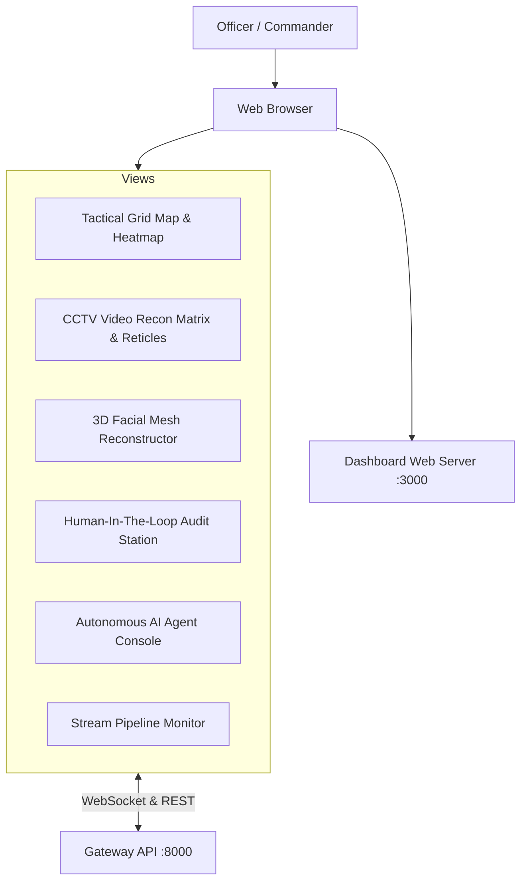

# ARGUS Sentinel - Tactical Dashboard Module Documentation

Next-generation Command Center frontend inspired by high-threat cartography and tactical reconnaissance consoles.

## Module Tree Structure

```text
services/tactical-dashboard/
├── Dockerfile
├── pyproject.toml
├── README.md
├── public/
│   └── index.html
└── src/
    └── main.py
```

## Workflow Diagram



<details>
<summary>Click to Expand Technical Capabilities</summary>

### Features
1. **Interactive Cartography**: High-contrast dark basemap with pulsing threat markers, sector filtering, and inter-node vector arcs.
2. **CCTV Target HUD**: Video surveillance frame with tracking brackets, vertical biometric scan animations, verified dossier popups, and technical telemetry panels.
3. **Three.js 3D Facial Mesh**: Interactive 468-point cranial wireframe with rotation controls (pitch, yaw, roll) and landmark topology storage.
4. **Human-In-The-Loop Modal**: Split verification station for approving, rejecting, or escalating suspect detections with operator audit logging.
5. **Autonomous Agent Interface**: On-demand generation of investigation dossiers leveraging local neural engines.
</details>
