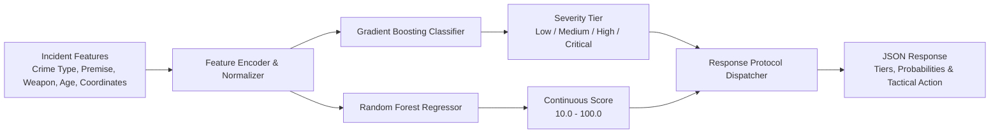

# ARGUS Sentinel - Crime Prediction Microservice

Real-time incident severity classification, regression scoring, and spatial-temporal hotspot forecasting engine. This service replaces cloud-locked neural services with 100% free, local, open-source ensemble modeling.

## Architecture and Responsibilities

- **Dual-Head Severity Engine**: Computes continuous severity scores (0 to 100) via Random Forest Regressor and categorical tiers (Low, Medium, High, Critical) via Gradient Boosting Classifiers.
- **Spatial-Temporal Clustering**: Aggregates municipal crime patterns into dynamic risk heatmaps and composite threat vectors.
- **Automated Lifecycle**: Features self-training capabilities, metrics evaluation, and zero-downtime weight reloads.

## Module Tree Structure

```text
services/crime-prediction-service/
├── Dockerfile
├── pyproject.toml
├── README.md
└── src/
    ├── config.py
    ├── hotspot_forecaster.py
    ├── main.py
    └── model_trainer.py
```

## Prediction Workflow Diagram



<details>
<summary>Click to Expand Architectural Details</summary>

### API Endpoint Reference

- `POST /predict/severity`: Single incident scoring.
- `POST /predict/batch`: High-throughput vectorized batch classification for historical ingestion.
- `GET /predict/hotspots`: Dynamic risk clusters by geographic sector.
- `POST /train`: On-demand retraining on updated municipal datasets.
- `GET /metrics`: Current model performance benchmarks (Accuracy, Weighted F1, RMSE).

### Feature Engineering Specifications

1. Categorical variables (`crime_type`, `premise_type`, `weapon_type`) are transformed via sparse-safe One-Hot Encoding.
2. Numeric dimensions (`victim_age`, `latitude`, `longitude`) undergo Standard Scaler normalization.
3. Class imbalance is handled with stratified cross-validation.
</details>

## Quickstart Instructions

### Prerequisites
- Python 3.10+
- Astral `uv` package manager
- Docker (optional)

### Option A: Local Run with uv

```bash
# Navigate to microservice directory
cd services/crime-prediction-service

# Create virtual environment and install dependencies
uv venv
uv pip install -r pyproject.toml

# Start the Prediction service
python -m uvicorn src.main:app --host 0.0.0.0 --port 8001 --reload
```

Interactive Swagger documentation: `http://localhost:8001/docs`

### Option B: Docker Container

```bash
docker build -t argus-prediction:latest .
docker run -d --name argus-prediction -p 8001:8001 argus-prediction:latest
```
