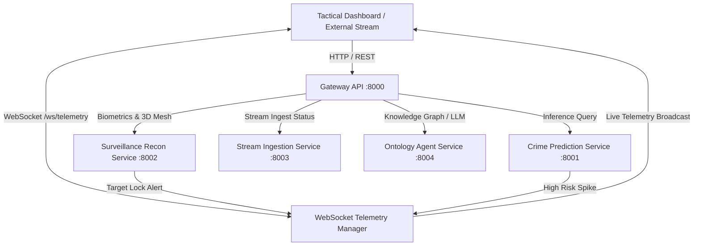

# ARGUS Sentinel - Gateway API Microservice

Central API Gateway, reverse proxy, and bidirectional WebSocket telemetry router for the ARGUS Sentinel platform. It unifies REST endpoints, orchestrates inter-service communication across all microservices, and distributes real-time incident broadcasts to command center interfaces.

## Architecture and Responsibilities

- **High-Throughput Gateway**: Routes client requests to specialized microservices (Crime Prediction, Surveillance Reconnaissance, Stream Ingestion, Ontology Agent).
- **WebSocket Telemetry Engine**: Pushes live incident notifications, biometric target locks, and human-in-the-loop decisions at millisecond latencies.
- **Unified OpenAPI Specification**: Exposes consolidated Swagger UI documentation for all platform capabilities.
- **Fail-Safe Circuit Breaking**: Implements graceful heuristic fallbacks in isolated development environments.

## Module Tree Structure

```text
services/gateway-api/
├── Dockerfile
├── pyproject.toml
├── README.md
└── src/
    ├── config.py
    ├── main.py
    └── websocket_manager.py
```

## System Workflow Diagram



<details>
<summary>Click to Expand Architectural Details</summary>

### Detailed Interface Specifications

1. **REST Interfaces**:
   - `GET /health`: Microservice readiness and active client session telemetry.
   - `GET /api/v1/incidents`: Query historical and real-time municipal crime incidents with sector and tier filters.
   - `POST /api/v1/incidents`: Ingest new incident, trigger automated severity classification, and publish broadcast event.
   - `POST /api/v1/predictions/severity`: On-demand multi-attribute risk and severity prediction.
   - `GET /api/v1/surveillance/cameras`: Active surveillance sensor inventory and spatial coverage parameters.
   - `GET /api/v1/surveillance/targets/active`: Current bounding box coordinates, track IDs, and match confidences.
   - `GET /api/v1/surveillance/profiles/3d/{id}`: Detailed 3D facial mesh vertices and depth topology.
   - `POST /api/v1/surveillance/hitl/verify`: Operator audit trail and human-in-the-loop verification commitment.

2. **WebSocket Interfaces**:
   - `ws://localhost:8000/ws/telemetry`: Bi-directional stream distributing real-time telemetry frames.
</details>

## Quickstart Instructions

### Prerequisites
- Python 3.10 or higher
- Astral `uv` package manager (`pip install uv` or `curl -LsSf https://astral.sh/uv/install.sh | sh`)
- Docker Engine (optional, for containerized execution)

### Option A: Local Run with uv (Recommended for Developers)

```bash
# Navigate to microservice directory
cd services/gateway-api

# Create virtual environment and sync dependencies
uv venv
uv pip install -r pyproject.toml

# Start the Gateway API service
python -m uvicorn src.main:app --host 0.0.0.0 --port 8000 --reload
```

The Swagger interactive documentation will be accessible at: `http://localhost:8000/docs`

### Option B: Containerized Execution with Docker

```bash
# Build Docker image
docker build -t argus-gateway:latest .

# Run container
docker run -d --name argus-gateway -p 8000:8000 argus-gateway:latest
```
