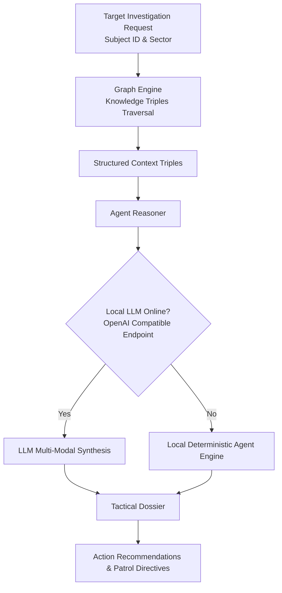

# ARGUS Sentinel - Ontology & Agentic Reasoning Microservice

Knowledge Graph and Autonomous AI Investigation Agent service. Integrates structured crime ontologies with local LLM inference engines (such as Gemma, Llama, DeepSeek) to autonomously analyze suspect networks and generate tactical law enforcement briefings.

## Architecture and Responsibilities

- **Crime Knowledge Graph**: Manages directional entity triples (`PersonOfInterest`, `CrimeIncident`, `SurveillanceSensor`, `SyndicateNetwork`, `WeaponSystem`).
- **Graph Traversal Engine**: Executes multi-hop relationship lookups and proximity clustering using NetworkX.
- **Agentic AI Investigator**: Prompts local OpenAI-compatible LLM endpoints with graph contexts, producing formatted tactical briefings with zero hallucinations.

## Module Tree Structure

```text
services/ontology-agent-service/
├── Dockerfile
├── pyproject.toml
├── README.md
└── src/
    ├── agent_reasoner.py
    ├── config.py
    ├── graph_engine.py
    └── main.py
```

## Agentic Reasoning Workflow



<details>
<summary>Click to Expand Architectural Details</summary>

### Knowledge Graph Schema

- Entities:
  - `PersonOfInterest`: Suspect identifiers, aliases, biometric signatures.
  - `CrimeIncident`: Incident reports, severity tiers, timestamps.
  - `SurveillanceSensor`: Fixed CCTV optical posts, coverage angles.
  - `SyndicateNetwork`: Organized crime collectives, specialties.
- Relational Predicates:
  - `INVOLVED_IN`, `LOCATED_IN`, `MONITORS_SECTOR`, `CAPTURED_TARGET`, `AFFILIATED_WITH`, `UTILIZED_WEAPON`.

### API Endpoints
- `GET /graph/schema`: Full ontology graph definition.
- `GET /graph/entity/{entity_id}`: All direct incoming and outgoing graph associations.
- `POST /agent/investigate`: Launch autonomous investigation on a target suspect.
</details>

## Quickstart Instructions

### Prerequisites
- Python 3.10+
- Astral `uv` package manager
- Docker (optional)

### Option A: Local Run with uv

```bash
cd services/ontology-agent-service

uv venv
uv pip install -r pyproject.toml

python -m uvicorn src.main:app --host 0.0.0.0 --port 8004 --reload
```

Interactive Swagger documentation: `http://localhost:8004/docs`

### Option B: Docker Container

```bash
docker build -t argus-ontology:latest .
docker run -d --name argus-ontology -p 8004:8004 argus-ontology:latest
```
