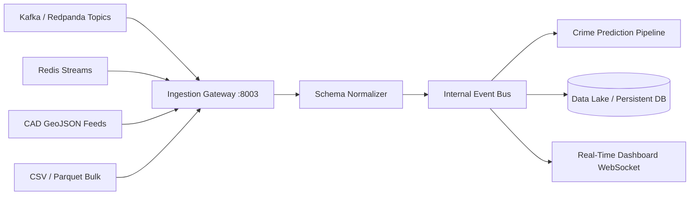

# ARGUS Sentinel - Stream Ingestion Microservice

High-throughput multi-protocol ingestion engine supporting Apache Kafka / Redpanda, Redis Streams, RTSP surveillance telemetry, and Emergency Dispatch (CAD) GeoJSON streams.

## Architecture and Responsibilities

- **Multi-Source Protocol Support**: Accepts inputs from distributed messaging brokers (Kafka/Redpanda), in-memory stream buffers (Redis), and geospatial feeds (CAD GeoJSON).
- **Schema Normalization**: Parses differing external payloads into canonical ARGUS Incident Records.
- **Backpressure and Fault Tolerance**: Provides fallback queuing when external brokers are temporarily unreachable.

## Module Tree Structure

```text
services/stream-ingestion-service/
├── Dockerfile
├── pyproject.toml
├── README.md
└── src/
    ├── config.py
    ├── main.py
    └── connectors/
        ├── batch_loader.py
        ├── geojson_stream.py
        ├── kafka_connector.py
        └── redis_connector.py
```

## Ingestion Architecture Diagram



<details>
<summary>Click to Expand Architectural Details</summary>

### Connector Implementations

1. **Kafka Connector**: Connects to `argus.incidents.raw` topic. Uses open-source client libraries with zero cloud-vendor locking.
2. **Redis Connector**: Appends normalized payloads to key `argus:stream:telemetry`.
3. **GeoJSON Parser**: Maps GIS properties (`call_id`, `priority_code`, `coordinates`) to standardized lat/lon floating point metrics.
4. **Batch Loader**: High-speed reader for bulk historical analyses.
</details>

## Quickstart Instructions

### Prerequisites
- Python 3.10+
- Astral `uv` package manager
- Docker (optional)

### Option A: Local Run with uv

```bash
cd services/stream-ingestion-service

uv venv
uv pip install -r pyproject.toml

python -m uvicorn src.main:app --host 0.0.0.0 --port 8003 --reload
```

Interactive Swagger documentation: `http://localhost:8003/docs`

### Option B: Docker Container

```bash
docker build -t argus-ingestion:latest .
docker run -d --name argus-ingestion -p 8003:8003 argus-ingestion:latest
```
