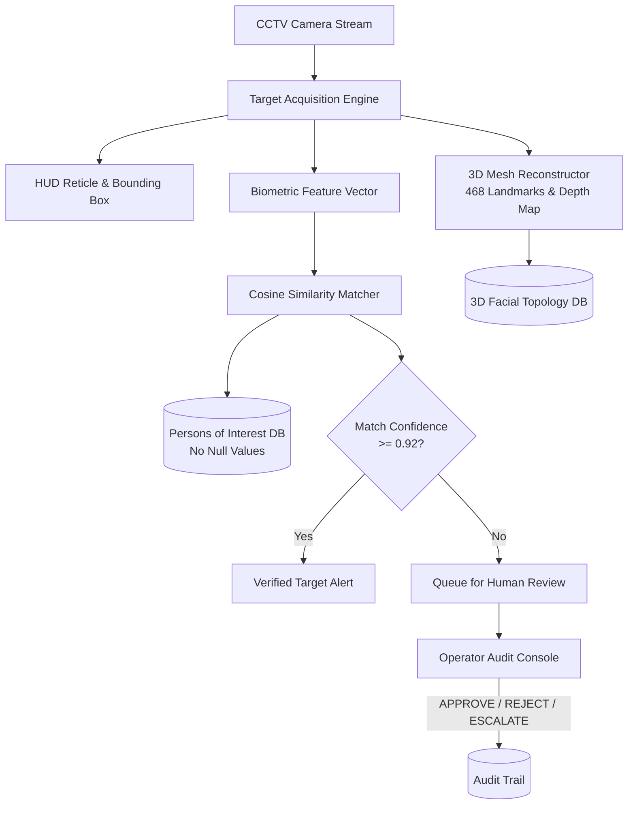

# ARGUS Sentinel - Surveillance Reconnaissance & 3D Profiling Microservice

Biometric reconnaissance, CCTV target acquisition, 3D facial mesh reconstruction, and Human-In-The-Loop (HITL) verification engine. Designed to process live tactical surveillance imagery, identify persons of interest against zero-null verified identity databases, and generate 3D wireframe models.

## Architecture and Responsibilities

- **CCTV Target Acquisition**: Implements reticle tracking, bounding box computation, and tracking identifier generation (`TRK-XXXX`).
- **Biometric Matching**: Performs cosine similarity matching across 128-dimensional embedding vectors against enrolled intelligence subjects.
- **3D Facial Mesh Reconstruction**: Synthesizes 468-point anthropometric landmark wireframes, calculates pitch/yaw/roll pose vectors, and stores 3D topology profiles.
- **Human-In-The-Loop (HITL) Review**: Queues low-confidence or high-threat biometric matches for operator verification and immutable audit logging.

## Module Tree Structure

```text
services/surveillance-recon-service/
├── Dockerfile
├── pyproject.toml
├── README.md
└── src/
    ├── biometric_matcher.py
    ├── config.py
    ├── hitl_engine.py
    ├── main.py
    └── mesh_3d_engine.py
```

## Surveillance Reconnaissance Workflow



<details>
<summary>Click to Expand Architectural Details</summary>

### 3D Reconstruction Specifications

1. Facial landmark topology uses canonical anthropometric points:
   - Frontal eye contours, pupils, and interpupillary distance (IPD).
   - Nose bridge ridge, crest, and tip coordinates.
   - Mouth inner/outer boundary loops and chin/jaw contour vertices.
2. Depth estimation maps produce relative $z$-plane displacements $[-1.0, 1.0]$.
3. Mesh geometry is exported as structured JSON vertices for WebGL/Three.js tactical rendering.

### Endpoints
- `POST /recon/match/vector`: Search database with a probe embedding.
- `GET /recon/subjects/{subject_id}`: Retrieve verified subject dossier.
- `GET /recon/profiles/3d/{subject_id}`: Fetch 3D facial topology mesh.
- `POST /recon/profiles/3d/reconstruct`: Trigger on-demand 3D landmark reconstruction.
- `GET /recon/hitl/queue`: List items requiring human verification.
- `POST /recon/hitl/verify`: Submit human operator decision.
</details>

## Quickstart Instructions

### Prerequisites
- Python 3.10+
- Astral `uv` package manager
- Docker (optional)

### Option A: Local Run with uv

```bash
# Navigate to microservice directory
cd services/surveillance-recon-service

# Create virtual environment and install dependencies
uv venv
uv pip install -r pyproject.toml

# Start the Surveillance Recon service
python -m uvicorn src.main:app --host 0.0.0.0 --port 8002 --reload
```

Interactive Swagger documentation: `http://localhost:8002/docs`

### Option B: Docker Container

```bash
docker build -t argus-surveillance:latest .
docker run -d --name argus-surveillance -p 8002:8002 argus-surveillance:latest
```
