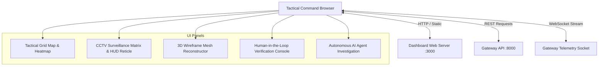

# ARGUS Sentinel - Tactical Dashboard Microservice

High-performance Command Center Web Application inspired by tactical intelligence maps and cyber-reconnaissance operations centers. Delivers real-time geospatial incident plotting, CCTV video HUD simulation with target locking reticles, 3D facial mesh reconstruction via Three.js, Human-In-The-Loop (HITL) audit verification, and Autonomous AI Agent investigation interfaces.

## Architecture and Responsibilities

- **Multi-Mode Mapping**: Integrates dark-matter cartographic tiles with pulsating severity markers, vector routing arcs, and sector boundary overlays.
- **CCTV Surveillance HUD**: Renders real-time targeting corner brackets, vertical biometric scan animations, verified subject dossier overlays, and telemetry stats panels directly aligned with real-world surveillance capture models.
- **Three.js 3D Facial Reconstructor**: Visualizes 468-point anthropometric wireframes with pitch, yaw, and roll controls, depth confidence estimations, and database persistence.
- **Human-In-The-Loop Audit Station**: Allows operational commanders to review ambiguous biometric target detections, confirm positive matches, filter false alarms, and preserve immutable audit histories.

## Module Tree Structure

```text
services/tactical-dashboard/
├── Dockerfile
├── pyproject.toml
├── README.md
├── public/
│   └── index.html
└── src/
    └── main.py
```

## Dashboard Interaction Flow



<details>
<summary>Click to Expand Architectural Details</summary>

### View Mode Specifications

1. **Tactical Grid Map View**:
   - Leaflet tile engine rendering dark vector topography.
   - Dynamic SVG circle markers styled by risk tier (Critical `#ff3366`, High `#ffaa00`, Medium `#00e5ff`, Low `#00ff9d`).
   - Sector interconnect arcs showing real-time command routing.
2. **CCTV Recon Matrix View**:
   - Bounding-box reticles tracking moving targets.
   - Animated scanning line.
   - Biometric profile card with technical traits and verified social links (GitHub, LinkedIn, X, Telegram).
3. **3D Facial Mesh View**:
   - WebGL Three.js point-cloud and wireframe sphere deformation simulating cranial anthropometry.
   - Pose angle rotation controls and depth metric gauges.
4. **HITL Review View**:
   - Operator decision interface (`APPROVE_MATCH`, `REJECT_FALSE_POSITIVE`, `ESCALATE_ALERT`).
</details>

## Quickstart Instructions

### Prerequisites
- Python 3.10+
- Astral `uv` package manager
- Modern Web Browser (Chrome, Firefox, Edge, Safari)

### Option A: Local Run with uv

```bash
cd services/tactical-dashboard

uv venv
uv pip install -r pyproject.toml

python -m uvicorn src.main:app --host 0.0.0.0 --port 3000 --reload
```

Open your browser to: `http://localhost:3000`

### Option B: Docker Container

```bash
docker build -t argus-dashboard:latest .
docker run -d --name argus-dashboard -p 3000:3000 argus-dashboard:latest
```
